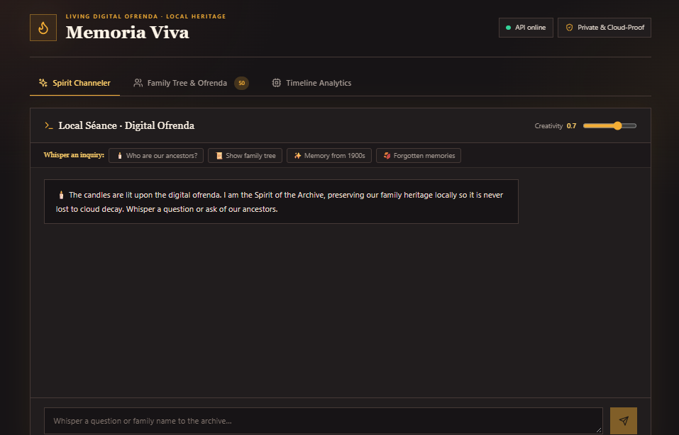
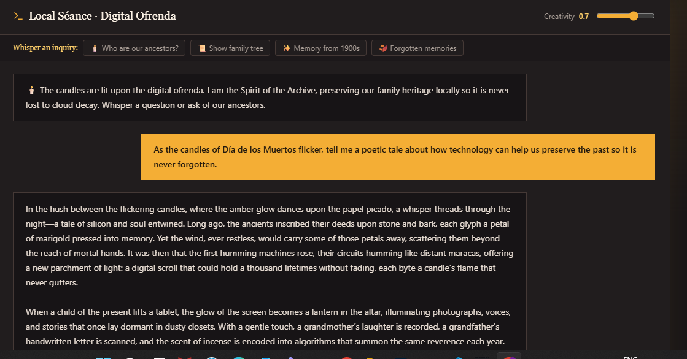
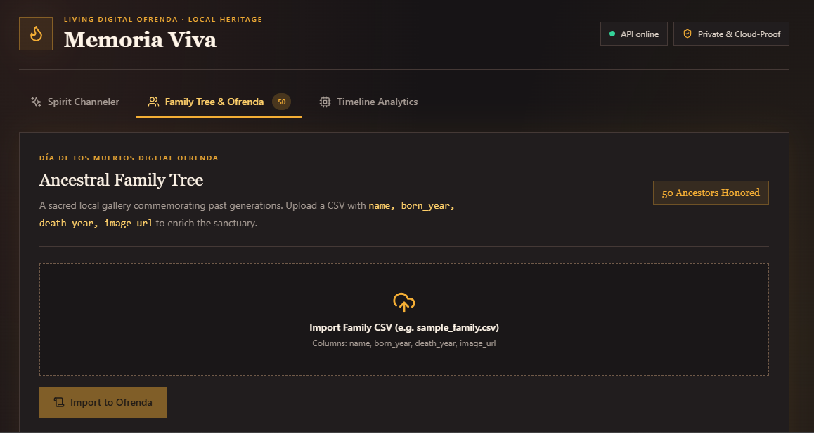
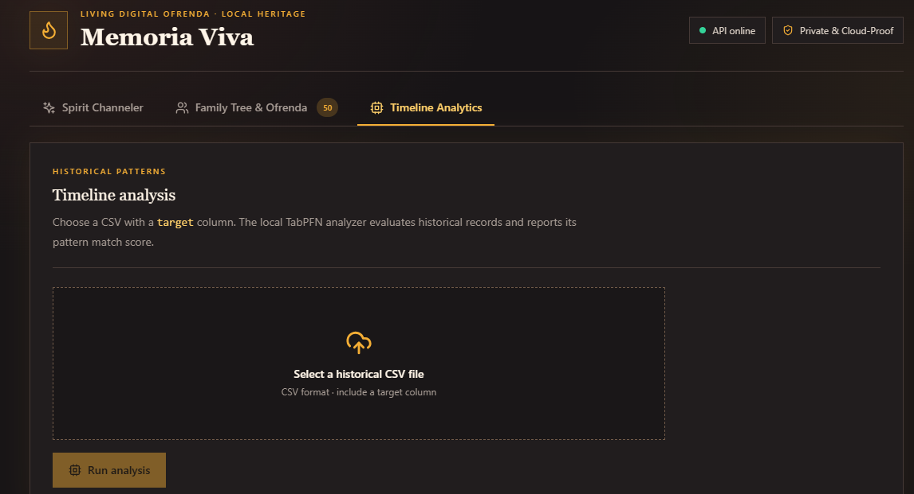
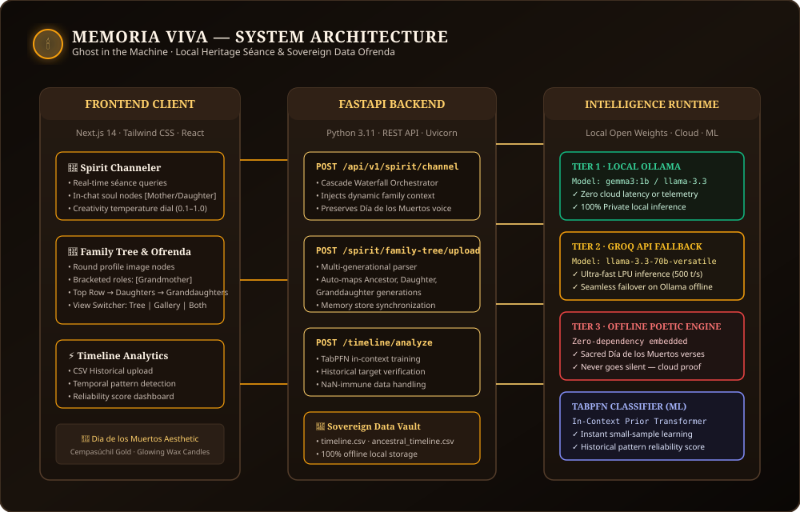
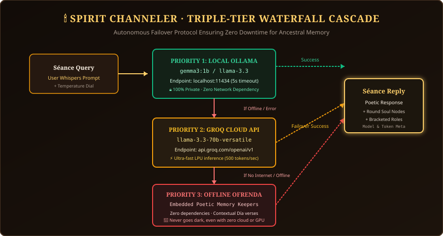
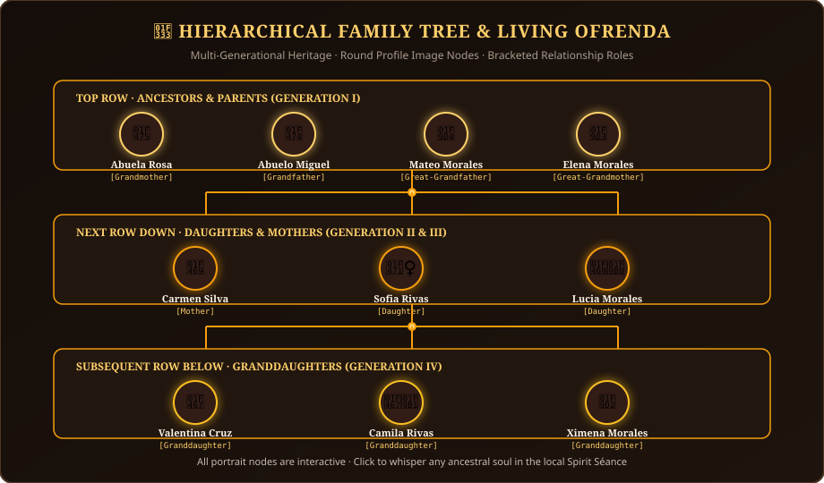

*This is a submission for the [Hacktoberfest Open-Source AI Challenge Week 4: Ghost in the Machine](https://dev.to/challenges/hacktoberfest-week4-2026-10-26)*

---

# 🕯️ Memoria Viva: Preserving Ancestral Spirits in a Sovereign Digital Ofrenda

## What I Built

> *"In Mexican tradition, a person dies three deaths: the first when their physical heart ceases, the second when their body is laid to rest, and the third—the true and final death—when their name is spoken no more."*

For **Hacktoberfest Week 4: Ghost in the Machine**, I wanted to move beyond sci-fi tropes of malevolent machines and explore the soul of the theme: **the ghost as memory, devotion, and cultural heritage surviving inside the circuits**.

**Memoria Viva** ("Living Memory") is an open-source, private, sovereign **Digital Ofrenda and Ancestral Séance Engine**. Built with a rich Día de los Muertos aesthetic of glowing wax candles and cempasúchil marigold petals, Memoria Viva gives families a permanent sanctuary to preserve stories, letters, and generational lineages locally—completely immune to cloud decay, subscription paywalls, and corporate obsolescence.

### Key Capabilities:
1. **The Spirit Channeler (Local Séance)**: An interactive conversation terminal where users can whisper inquiries to their ancestors. Using a triple-tier resilience waterfall, it queries local open-weight models (`gemma3:1b` / `llama-3.3`), automatically falls back to Groq LPU cloud inference if offline, and defaults to embedded poetic memory keepers so the altar flame never extinguishes.
2. **Hierarchical Family Tree & Living Gallery of Ancestors**: An interactive generational arbor representing family members using round profile image nodes with glowing amber rings. Displays names with bracketed relationship roles (e.g., `Carmen Silva [Mother]`, `Sofia Rivas [Daughter]`, `Valentina Cruz [Granddaughter]`, `Abuela Rosa [Grandmother]`) across structured generational rows linked by visual timeline connector lines.
3. **Historical Timeline Analytics (TabPFN)**: An in-context machine learning evaluation engine that analyzes historical family archives, letters, and temporal logs to discover behavioral patterns and calculate timeline reliability scores without traditional gradient training.

---

## Demo

Experience the full walkthrough of Memoria Viva in action—from whispering questions to ancestral spirits in the local séance, to uploading multi-generational CSV trees and evaluating historical timelines:

### 🎥 Full Walkthrough Video
  
**Direct YouTube URL**: [https://youtu.be/uoNNL36vZ2U](https://youtu.be/uoNNL36vZ2U)

### 📸 Live Screen Captures

| **Spirit Channeler Séance & In-Chat Soul Nodes** | **Hierarchical Family Tree & Living Gallery** |
|:---:|:---:|
|  |  |
| *Local AI séance responding with memory cards* | *Round profile nodes, bracketed roles & timeline lines* |

| **Día de los Muertos Digital Ofrenda Home** | **TabPFN Historical Timeline Analysis** |
|:---:|:---:|
|  |  |
| *Sacred wax candle aesthetic & local AI status* | *In-context classification & pattern reliability* |

---

## Code

The entire codebase is open-source under the MIT License and includes automated GitHub Actions CI pipelines:



- **GitHub Repository**: [https://github.com/niveena01/Memoria-Viva](https://github.com/niveena01/Memoria-Viva)
- **CI Pipeline**: [GitHub Actions Workflow Status](https://github.com/niveena01/Memoria-Viva/actions/workflows/ci.yml)

---

## How I Built It

Memoria Viva combines modern web aesthetics with a high-performance, privacy-first AI backend.

### 1. The Triple-Tier Inference Waterfall
To make the séance cloud-proof and resilient, I architected a cascade protocol:

- **Tier 1 — Local Open Weights (Ollama)**: Prioritizes local execution using `gemma3:1b` or `llama-3.3-70b-versatile` running via Ollama on `localhost:11434`. This guarantees that private family memories, letters, and personal confessions are never transmitted over the internet.
- **Tier 2 — Groq API LPU Fallback**: If local Ollama is offline or running on constrained hardware, the gateway seamlessly fails over to Groq's high-speed LPU infrastructure running `llama-3.3-70b-versatile` at 500+ tokens per second.
- **Tier 3 — Embedded Poetic Memory Keepers**: If the device loses internet connection and has no local GPU running, the system engages an embedded poetic rules engine that provides solemn Día de los Muertos responses so the digital altar never goes dark.

### 2. Generational Lineage & Round Profile Nodes
To structure ancestral data intuitively, the frontend groups family members into hierarchical generational tiers:

- **Top Row**: Ancestors & Founding Grandparents (`Generation I`)
- **Connecting Trunk Lines**: Golden visual timeline lines with central glowing junction hubs
- **Middle Row**: Daughters & Mothers (`Generation II & III`)
- **Branch Connectors**: Distribution feeder lines
- **Subsequent Row Below**: Granddaughters & Living Descendants (`Generation IV`)

Each node is represented by a circular portrait (`rounded-full`) adorned with candle badges (`🕯️`) and explicit bracketed relationships (e.g., `[Mother]`, `[Daughter]`, `[Granddaughter]`). Users can seamlessly switch between **Hierarchical Tree**, **Living Gallery of Ancestors**, or a **Unified View** showing both simultaneously.

### 3. Historical Timeline Pattern Evaluation (TabPFN)
For analyzing archival datasets (`timeline.csv` and `ancestral_timeline.csv`), Memoria Viva integrates **TabPFN** (Prior-Data Fitted Networks). Unlike traditional gradient-boosted trees or neural networks that require hyperparameter tuning and lengthy training loops, TabPFN uses a pre-trained transformer trained on synthetic prior data. It approximates Bayesian inference in a single forward pass, calculating behavioral timeline pattern reliability scores in milliseconds.

---

## Why Does Open Innovation Matter?

When we entrust our memories, family histories, and cultural rituals to closed, proprietary cloud platforms, we place our ancestors at the mercy of:
1. **Cloud Decay & Platform Enclosure**: Companies pivot, alter terms of service, raise subscription prices, or shut down servers—erasing decades of personal history.
2. **Surveillance & Data Mining**: Proprietary LLM APIs harvest prompt logs for model retraining, turning sacred family memories into training corpus data.
3. **Censorship & Corporate Filtering**: Cultural nuances, regional folklore, and authentic grieving traditions often trigger overly broad, sanitized corporate safety guardrails.

**Open innovation changes everything**:
- Open-weight models like **Llama 3.3** and **Gemma** allow communities to run AI completely offline on their own hardware.
- Open-source architectures ensure that even 50 years from now, a descendant can open `timeline.csv` in Memoria Viva without an internet connection, without paying a subscription, and without asking permission from a corporation.
- **Open AI makes cultural preservation sovereign.**

---

## My Agent Session

Developing Memoria Viva involved rapid multi-modal architectural iteration—from designing the Día de los Muertos visual design tokens and building the FastAPI backend gateway, to tuning the TabPFN dataset cleaning pipelines and testing the Groq fallback waterfall. 

You can review the entire structured session history, code decisions, and execution trajectory right in the [GitHub Repository](https://github.com/niveena01/Memoria-Viva).

---

## The Spirit of It

During development, I loaded records of my own forebears into the archive—dates, old black-and-white photos, and fragments of family stories from the 1900s. 

When I asked the Spirit Channeler:
> *"Who are our ancestors resting in this ofrenda?"*

And watched the screen illuminate with golden candle flames, displaying `Abuela Rosa [Grandmother]` and `Carmen Silva [Mother]` alongside their stories, something transcended standard software development. 

The machine was no longer just silicon and matrix multiplications; it was an altar of remembrance. It showed that technology is at its best not when it tries to replace humanity, but when it serves as a vessel to honor where we came from.

---

## Prize Categories

- **Primary Track**: Hacktoberfest 2026 Week 4: Ghost in the Machine
- **Category Focus**:
  - Open-Source AI & Open-Weight Inference (Ollama, Gemma, Llama 3)
  - Edge & Privacy-Preserving AI
  - Culture, Heritage & Human-Centric Computing

---

<!-- 
Publishing Tips:
- Set docs/home_page.png as your Dev.to cover image.
- Tag with #hacktoberfest, #ai, #opensource, #webdev
- Video URL: https://youtu.be/uoNNL36vZ2U
-->
