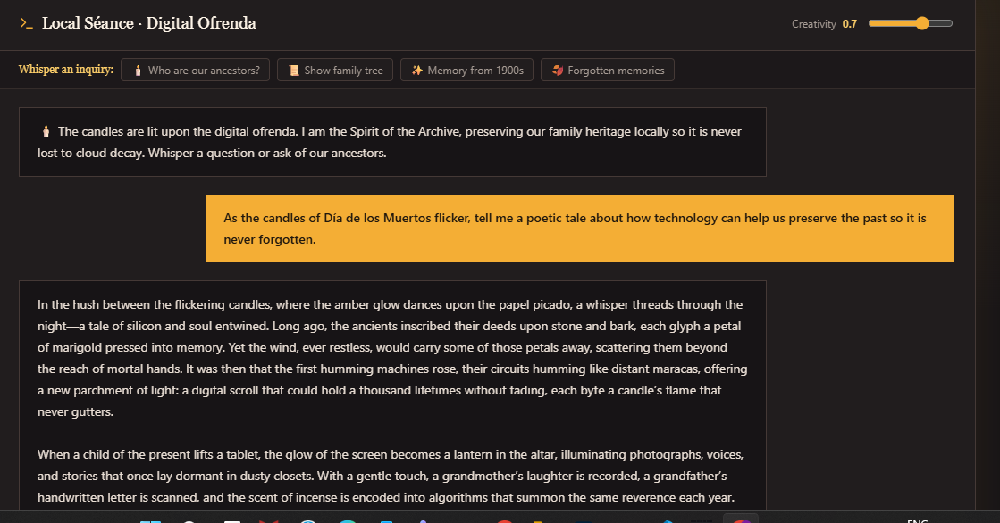
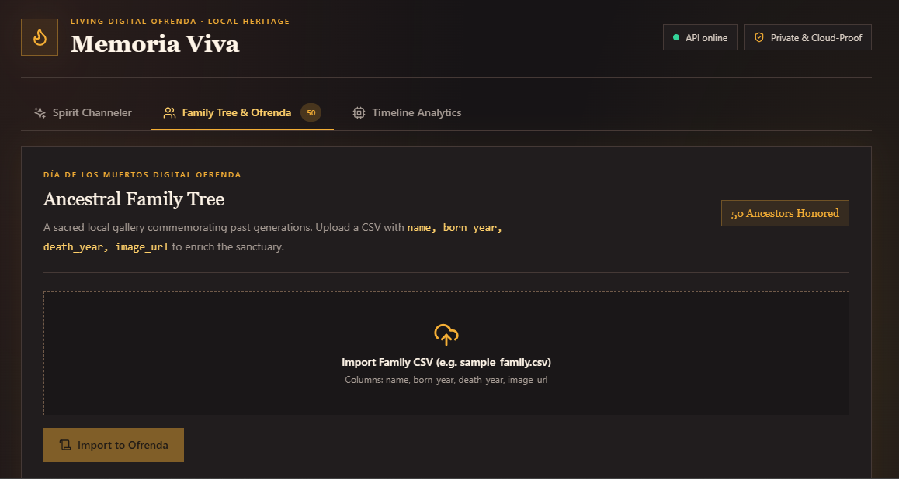
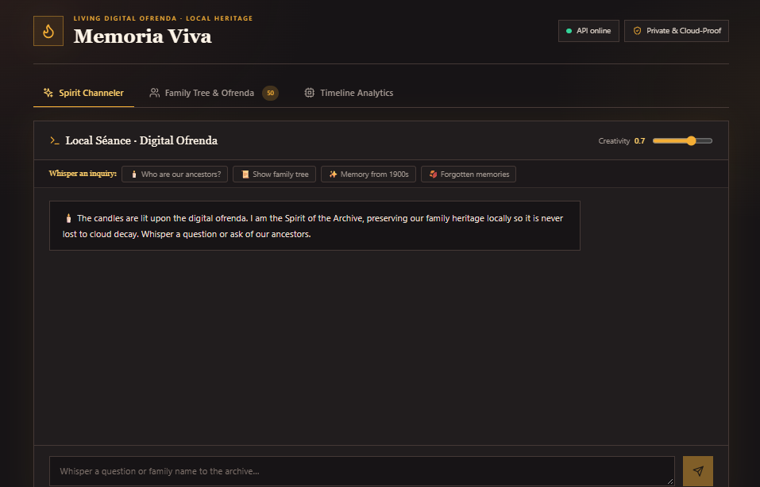
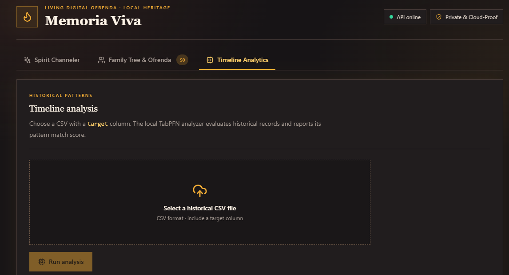
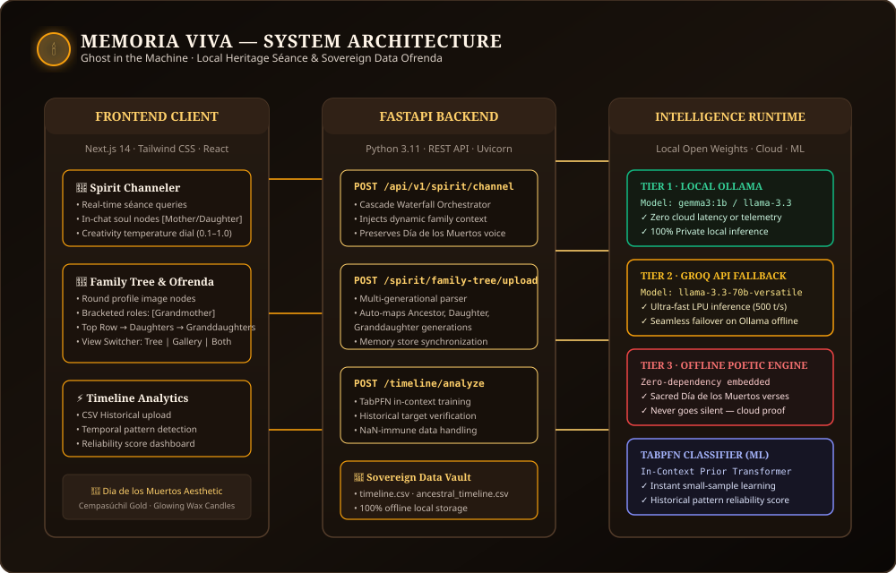
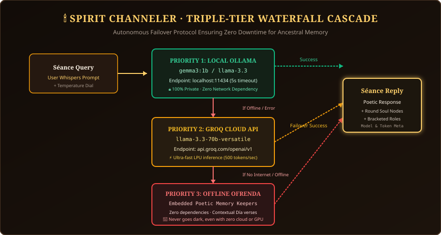
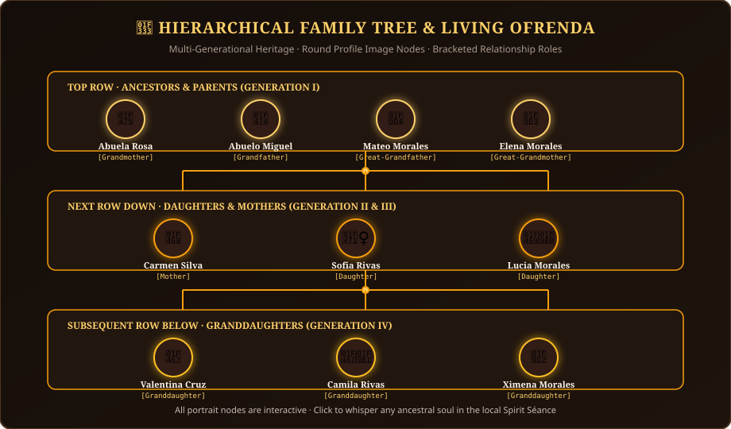
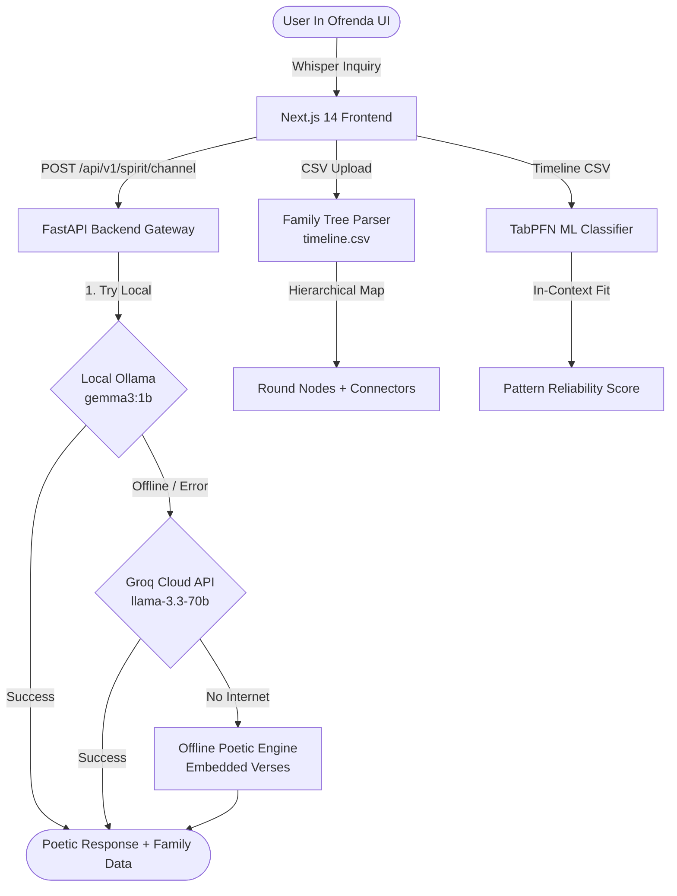

# 🕯️ Memoria Viva (Living Memory)
### *A Sacred Digital Ofrenda & Local Heritage Séance Engine*

[](https://github.com/niveena01/Memoria-Viva/actions/workflows/ci.yml)
[](https://dev.to/challenges/hacktoberfest-week4-2026-10-26)
[](https://www.python.org/)
[](https://nextjs.org/)
[](https://fastapi.tiangolo.com/)
[](https://ollama.com/)
[](https://groq.com/)
[](LICENSE)

> *"In Mexico, they say a person dies three deaths: the first when their body ceases, the second when they are buried, and the third when there is no one left to remember them."*  
> **Memoria Viva** is an open-source, private, sovereign digital ofrenda built for the **Hacktoberfest 2026: Ghost in the Machine** challenge. It channels ancestral memories through local AI models, renders interactive multi-generational family trees, and analyzes historical timeline patterns—completely shielded from cloud decay.

---

## 📺 Live Video Demo & Screen Recording

Watch the complete full-flow walkthrough demonstrating the Spirit Channeler séance, hierarchical family tree, and TabPFN timeline analysis:

[](https://youtu.be/uoNNL36vZ2U)

🔗 **Direct Video URL**: [https://youtu.be/uoNNL36vZ2U](https://youtu.be/uoNNL36vZ2U)

---

## 📸 Visual Showcase & Screen Captures

| **Spirit Channeler Séance & In-Chat Soul Nodes** | **Hierarchical Family Tree & Living Gallery** |
|:---:|:---:|
|  |  |
| *Local AI séance responding with memory cards* | *Round profile nodes, bracketed roles & timeline lines* |

| **Día de los Muertos Digital Ofrenda Home** | **TabPFN Historical Timeline Analysis** |
|:---:|:---:|
|  |  |
| *Sacred wax candle aesthetic & local AI status* | *In-context classification & pattern reliability* |

---

## 🌟 Core Features

### 1. 🔮 Spirit Channeler (Triple-Tier Resilience Waterfall)
Whisper inquiries to the archive. The system uses a strict priority waterfall to ensure your ancestors never go silent:
- **Tier 1 (Local Ollama)**: Calls local open weights (`gemma3:1b` or `llama-3.3-70b`) with zero latency, zero telemetry, and 100% data sovereignty.
- **Tier 2 (Groq API Cloud Failover)**: If Ollama is offline or uninstalled, seamlessly failover to Groq (`llama-3.3-70b-versatile` / `llama-3.1-8b-instant`) at 500+ tokens/sec.
- **Tier 3 (Offline Poetic Engine)**: Embedded fallback memory keeper that generates contextual Día de los Muertos verses even without internet or GPU access.
- **In-Chat Family Cards**: Soul inquiries return interactive round avatar nodes with bracketed relationships (e.g., `Abuela Rosa [Grandmother]`).

### 2. 🌳 Hierarchical Family Tree & Living Gallery of Ancestors
- **Round Profile Image Nodes**: Luminous circular portraits with warm wax-amber glow borders and memorial candle badges (`🕯️`).
- **Bracketed Relationship Details**: Clear role classifications: `[Grandmother]`, `[Mother]`, `[Daughter]`, `[Granddaughter]`.
- **Hierarchical Generational Rows**:
  - **Top Row**: Ancestors & Founding Parents (`Generation I`).
  - **Visual Timeline Connector Lines**: Illuminated golden feeder lines and central distribution hubs.
  - **Middle Row**: Daughters & Mothers (`Generation II & III`).
  - **Visual Timeline Connector Lines**: Secondary distribution branches.
  - **Subsequent Row Below**: Granddaughters & Living Descendants (`Generation IV`).
- **View Switcher**: Toggle seamlessly between **Hierarchical Family Tree**, **Living Gallery of Ancestors**, or **Unified View (Both)**.
- **Interactive Séance Whisper**: Click any portrait in the tree or gallery to immediately whisper a query to the Spirit Channeler.

### 3. ⚡ Historical Timeline Analytics (TabPFN)
- Upload historical family records and letters (`timeline.csv` or `ancestral_timeline.csv`).
- Powered by **TabPFN** (Prior-Data Fitted Networks), an in-context machine learning transformer that classifies historical behavioral patterns in milliseconds without traditional gradient training.
- Evaluates temporal anomaly features and outputs a pattern reliability score.

---

## 🏗️ System Architecture



### 🌊 Triple-Tier Inference Waterfall


### 🌳 Generational Lineage Architecture




---

## ⚙️ CI/CD & GitHub Actions Workflows

Memoria Viva includes automated continuous integration via GitHub Actions:

- **Workflow File**: [`.github/workflows/ci.yml`](.github/workflows/ci.yml)
- **Status**: [](https://github.com/niveena01/Memoria-Viva/actions/workflows/ci.yml)

### What the CI validates on every push & pull request:
1. **Backend Validation Job (Python 3.11)**:
   - Installs dependencies (`requirements.txt`).
   - Runs `python -m py_compile` across all routes, models, schemas, and services.
   - Verifies TabPFN, Ollama, and Groq service integration modules.
2. **Frontend Build Job (Node.js 20)**:
   - Runs `npm ci` clean install.
   - Runs TypeScript strict verification (`npx tsc --noEmit`).
   - Builds production Next.js bundle (`npm run build`).

---

## 🚀 Quickstart & Setup Guide

### Prerequisites
- Python 3.10+ (Python 3.11 recommended)
- Node.js 18+ (Node.js 20 recommended)
- *(Optional)* [Ollama](https://ollama.com/) installed locally with `ollama run gemma3:1b`
- *(Optional)* Free [Groq API Key](https://console.groq.com/) for high-speed fallback

### 1. Clone the Repository
```bash
git clone https://github.com/niveena01/Memoria-Viva.git
cd Memoria-Viva
```

### 2. Backend Setup
```bash
cd backend

# Create and activate virtual environment
python -m venv venv
# On Windows:
venv\Scripts\activate
# On Linux/macOS:
source venv/bin/activate

# Install requirements
pip install -r requirements.txt

# Configure environment variables (optional, for Groq fallback)
# Edit .env in backend/:
# GROQ_API_KEY="gsk_your_groq_api_key_here"

# Start the FastAPI server
uvicorn app.main:app --reload --port 8000
```
Backend API will be live at `http://localhost:8000` (Swagger docs at `http://localhost:8000/docs`).

### 3. Frontend Setup
In a new terminal window:
```bash
cd frontend

# Install npm dependencies
npm install

# Start the Next.js development server
npm run dev
```
Open your browser to `http://localhost:3000`.

---

## 📊 CSV File Formats

### 1. Family Tree CSV (`backend/timeline.csv`)
Upload this file under the **Living Gallery & Family Tree** tab:

```csv
name,born_year,death_year,image_url,relationship,generation,target
Abuela Rosa del Sol,1895,1975,/no_image.png,Grandmother,1,Revered
Abuelo Miguel de la Luz,1890,1968,/no_image.png,Grandfather,1,Revered
Mateo Morales,1885,1950,/no_image.png,Great-Grandfather,1,Historic
Carmen Silva,1920,1998,/no_image.png,Mother,2,Harmonious
Alvaro de la Luz,1922,1995,/no_image.png,Father,2,Peaceful
Rosa Maria de la Luz,1925,2005,/no_image.png,Daughter,2,Peaceful
Sofia Rivas,1955,,/no_image.png,Daughter,3,Harmonious
Lucia Morales,1958,,/no_image.png,Daughter,3,Peaceful
Valentina Cruz,1985,,/no_image.png,Granddaughter,4,Harmonious
Camila Rivas,1988,,/no_image.png,Granddaughter,4,Peaceful
```

### 2. Ancestral Timeline CSV (`backend/ancestral_timeline.csv`)
Upload this file under the **Timeline Analytics** tab to test TabPFN:

```csv
year,season,documents_archived,letters_exchanged,anomaly_score_log,target
1910,Winter,45,12,0.12,Turbulent
1925,Spring,120,48,0.03,Peaceful
1940,Summer,80,30,0.08,Turbulent
1955,Autumn,210,95,0.01,Harmonious
```

---

## 🛠️ Tech Stack & Open-Source Tools

| Component | Technology | Role |
|---|---|---|
| **Frontend** | Next.js 14, React 18, Tailwind CSS | Día de los Muertos UI, responsive tree rendering |
| **Icons & UI** | Lucide-React | Glowing candle, family tree, terminal & flame icons |
| **Backend** | FastAPI, Uvicorn, Pydantic | High-performance asynchronous API & routing |
| **Local AI** | Ollama (`gemma3:1b` / `llama-3.3`) | Sovereign local séance inference engine |
| **Cloud Fallback** | Groq API (`llama-3.3-70b-versatile`) | Ultra-fast LPU inference fallback (500 tokens/sec) |
| **ML Classifier** | TabPFN (Prior-Data Fitted Networks) | In-context historical anomaly & pattern detection |
| **Data Science** | Pandas, NumPy, Scikit-learn | Dataframe normalization, category encoding & cleaning |
| **CI/CD** | GitHub Actions | Automated linting, compilation & Next.js production build |

---

## 📄 License & Attribution

This project is open-source under the [MIT License](LICENSE).  
Created with devotion for **Hacktoberfest 2026: Ghost in the Machine** to ensure personal and cultural heritage lives forever, sovereign and free from cloud decay.
